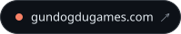
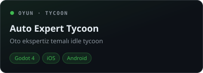
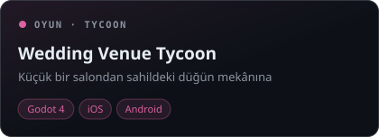
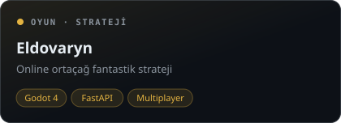
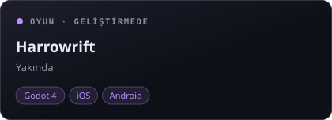
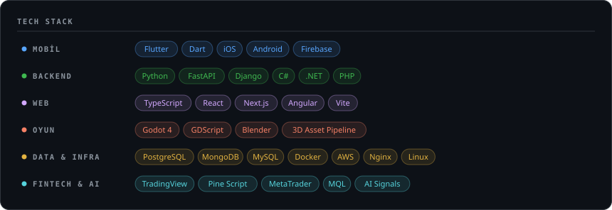

&nbsp;

  

  

  

  

<picture>
  <source media="(prefers-color-scheme: dark)" srcset="https://raw.githubusercontent.com/semigundogdu/semigundogdu/output/snake-dark.svg" />
  
</picture>

